# Markdown 语法全量测试文档

> 本文档用于测试 Obsidian 中所有 Markdown 语法的渲染效果。行内级语法（强调、行内代码、行内链接、脚注、行内公式、HTML 内联、转义、emoji、行内标签）已合并进第 1 节的真实段落中测试；块级语法仍按章节单独测试。

---

## 1. 段落与行内语法 Paragraph & Inline

### 纯中文段落（含强调）

知识管理的核心不在于收集，而在于**连接**。当一条笔记能够*主动指向*另一条笔记时，零散的信息才会沉淀为***可复用的结构化知识***。~~每天写很多~~并不现实，==坚持每天写一点==比偶尔爆发更重要。

### 纯英文段落

The real value of a note-taking system emerges only when notes start to reference each other. A single **isolated** note is just a *fragment*, but a well-connected network becomes a ***second brain*** that thinks alongside you. Consistency beats intensity.

### 中英文混合段落（含行内链接与脚注）

很多人误以为 Personal Knowledge Management 只是把文章存下来，其实 PKM 的关键是 atomic notes（原子笔记）之间的 linking[^link]。一篇好的笔记应该足够 self-contained（自成一体），同时能通过 [双向链接](https://obsidian.md) 嵌入更大的 context（语境）之中[^note]。

[^link]: 脚注：linking 指笔记之间的双向引用关系。

[^note]: 这是具名脚注，支持**格式化**内容。

### 行内代码混合段落

在终端运行 `obsidian-cli search "keyword"` 可以 `检索` 整个 vault；`批量重命名` 时配合 `mv` 与正则处理 `YYYYMMDDHHmm-` 前缀。插件清单位于 `.obsidian/community-plugins.json`，修改后需 reload 才生效。变量 `count` 的类型是 `number`。

### 行内公式、HTML 内联与转义

行内公式：质能方程 $E = mc^2$，求根公式 $x = \dfrac{-b \pm \sqrt{b^2 - 4ac}}{2a}$。HTML 内联：上标 X<sup>2</sup>、下标 H<sub>2</sub>O、快捷键 <kbd>Ctrl</kbd> + <kbd>C</kbd>、<mark>HTML 高亮</mark>。转义字符：\*不是斜体\*、\`不是代码\`、\[不是链接\]、\# 不是标题。Emoji：🚀 ✅ ⚠️ 📝 🎉。

### 软换行与 Obsidian 行内语法

这是第一段落。段落之间用空行分隔。

这一行末尾有两个空格，所以下一行是软换行（Line Break）。  
这就是软换行后的内容。正文标签 #测试标签 #markdown，嵌套标签 #项目/前端 #项目/后端，行内注释 %%这段在阅读视图不会显示%% 后面还有内容。

---

## 2. 标题 Headings

# H1 一级标题
## H2 二级标题
### H3 三级标题
#### H4 四级标题
##### H5 五级标题
###### H6 六级标题

---

## 3. 引用 Blockquote

> 这是一级引用。
>
> > 这是二级引用（嵌套）。
> >
> > > 这是三级引用。

---

## 4. 列表 Lists

### 无序列表

- 苹果
- 香蕉
  - 大蕉
  - 小米蕉
    - 芝麻蕉
- 橙子

### 有序列表

1. 第一步
2. 第二步
   1. 子步骤 A
   2. 子步骤 B
3. 第三步

### 任务列表

- [x] 已完成的任务
- [ ] 未完成的任务
- [x] 另一个完成项
- [ ] 待办事项

---

## 5. 代码块 Code Blocks

### 代码块（无语言）

```
这是一段普通代码块
没有语法高亮
```

### 代码块（JavaScript）

```javascript
// 斐波那契数列
function fibonacci(n) {
  if (n <= 1) return n;
  return fibonacci(n - 1) + fibonacci(n - 2);
}

console.log(fibonacci(10)); // 55
```

### 代码块（Python）

```python
# 列表推导式
squares = [x**2 for x in range(1, 11)]
print(squares)  # [1, 4, 9, 16, 25, 36, 49, 64, 81, 100]
```

### 代码块（Bash）

```bash
#!/bin/bash
echo "Hello, World!"
for i in {1..5}; do
  echo "Count: $i"
done
```

### 代码块（JSON）

```json
{
  "name": "markdown-test",
  "version": "1.0.0",
  "tags": ["test", "markdown"],
  "active": true
}
```

### 代码块（Diff）

```diff
- const a = 1;
+ const a = 2;
  const b = 3;
```

### 代码块（带文件名标题）

部分主题/插件支持在围栏信息中写文件名作为标题：

```js title="utils.js"
export const sum = (a, b) => a + b;
```

---

## 6. 水平分割线 Horizontal Rule

三种写法，效果相同：

---

***

___

---

## 7. 链接 Links

### 带标题的链接

[带标题的链接](https://obsidian.md "Obsidian - A second brain")

### 引用链接

这是一个[引用链接][obsidian-ref]，定义在文档底部。

[obsidian-ref]: https://obsidian.md "Obsidian"

### 裸链接

<https://obsidian.md>

<test@example.com>

### Obsidian 内部链接（Obsidian 特有）

[[202512191514-readme]]

[[202512191514-readme|自定义显示文字]]

> [!WARNING] 关于上面的 alias 写法
> `[[文件|别名]]` 这种 alias wikilink 本项目已**全局禁用**：`|` 会与 Markdown 表格的列分隔符冲突，破坏表格渲染。此处仅作语法演示，实际写作请改用标准 Markdown 链接 `[别名](文件.md)`。

### 链接到标题与块（Obsidian 特有）

链接到笔记内的某个标题：[[202512191514-readme#⭐ Optional Settings]]

链接到笔记内的某个块（配合第 11 节的 `^block-id`）：[[202603212136-Obsidian-Markdown-全格式测试#^block-id-example]]

同一篇文档内跳转到标题：[[#9. 表格 Tables]]

---

## 8. 图片 Images

### 外部图片


### 带标题的图片


### Obsidian 内部图片嵌入语法（Obsidian 特有）

![[assets/00450da751952d255991140f5b2c5ce1_MD5.webp]]

指定宽度（像素）：

![[assets/00450da751952d255991140f5b2c5ce1_MD5.webp|300]]

### Obsidian 笔记嵌入 / Transclusion（Obsidian 特有）

嵌入整篇笔记：

![[202512191514-readme]]

嵌入笔记的某个章节（标题）：

![[202603212136-Obsidian-Markdown-全格式测试#9. 表格 Tables]]

嵌入笔记的某个块：

![[202603212136-Obsidian-Markdown-全格式测试#^block-id-example]]

---

## 9. 表格 Tables

### 基础表格

| 姓名  | 年龄  | 职业   |
| --- | --- | ---- |
| 张三  | 28  | 工程师  |
| 李四  | 32  | 设计师  |
| 王五  | 25  | 产品经理 |

### 对齐方式

| 左对齐    |   居中对齐   |     右对齐 |
| :----- | :------: | ------: |
| 左      |    中     |       右 |
| Left   |  Center  |   Right |
| `left` | `center` | `right` |

### 单元格内换行与格式

单元格内用 `<br>` 换行，并可混用行内格式：

| 项目   | 说明                          |
| ------ | ----------------------------- |
| 多行   | 第一行<br>第二行<br>第三行    |
| 格式   | **粗体** 与 `代码` 与 ~~删除~~ |

---

## 10. 数学公式 Math（块级 LaTeX）

$$
\sum_{i=1}^{n} i = \frac{n(n+1)}{2}
$$

$$
\int_{-\infty}^{\infty} e^{-x^2} dx = \sqrt{\pi}
$$

$$
\begin{pmatrix}
a & b \\
c & d
\end{pmatrix}
\begin{pmatrix}
x \\
y
\end{pmatrix}
=
\begin{pmatrix}
ax + by \\
cx + dy
\end{pmatrix}
$$

多行对齐公式（align 环境）：

$$
\begin{align}
f(x) &= (x+1)^2 \\
     &= x^2 + 2x + 1
\end{align}
$$

> 行内公式见第 1 节。

---

## 11. HTML 块级与 Obsidian 特有语法

### 折叠块 details / summary

<details>
<summary>点击展开折叠内容</summary>

这里是被折叠的内容。

- 支持列表
- 支持**格式化**

</details>

### 块引用 ID（Obsidian 特有）

这是一个可被其他文档引用的段落。^block-id-example

### 块级注释 Comment（Obsidian 特有）

行内注释见第 1 节。块级注释（整段不渲染）：

%%
这是一段块级注释，
在阅读视图中完全隐藏。
%%

### Callout 块（Obsidian 特有）

> [!NOTE]
> 这是一个 Note callout，用于提示信息。

> [!TIP] 自定义标题
> 这是一个 Tip callout，支持自定义标题。

> [!WARNING]
> 这是一个 Warning callout，用于警告信息。

> [!INFO]- 可折叠的 Callout（默认折叠）
> 这个 callout 默认是折叠状态，点击标题可以展开。

> [!SUCCESS]+ 可折叠的 Callout（默认展开）
> 这个 callout 默认是展开状态，点击标题可以折叠。

更多类型：`ABSTRACT` / `QUESTION` / `EXAMPLE` / `FAILURE` / `BUG` / `TODO` / `CITE` / `DANGER` / `QUOTE` 等，用法一致。

### 嵌套 Callout（Obsidian 特有）

> [!NOTE] 外层 callout
> 外层内容。
>
> > [!TIP] 内层 callout
> > 嵌套进来的内容。

### Callout 内混排（Obsidian 特有）

> [!INFO] 内部可放各种元素
> 列表：
>
> - 第一项
> - 第二项
>
> 代码块：
>
> ```js
> console.log("inside callout");
> ```

---

## 12. 内嵌 HTML 测试 Embedded HTML

### 行内 style 属性（通常可渲染）

<span style="color:#e74c3c">红色文字</span>、<span style="background:#fff3cd;padding:2px 4px;border-radius:3px">带底色高亮</span>、<span style="font-size:1.4em;font-weight:bold">放大加粗</span>。

### div 块与盒模型

<div style="border:1px solid #2196f3;border-radius:6px;padding:12px;background:#e8f4f8">
  这是一个带边框、圆角和背景色的 <code>div</code> 盒子，用于测试块级 HTML 与内联样式。
</div>

### 两栏 flex 布局

<div style="display:flex;gap:12px">
  <div style="flex:1;padding:8px;background:#f0f0f0">左栏</div>
  <div style="flex:1;padding:8px;background:#e0e0e0">右栏</div>
</div>

### 原生 HTML 表格

<table>
  <thead>
    <tr><th>列 A</th><th>列 B</th></tr>
  </thead>
  <tbody>
    <tr><td>单元格 1</td><td>单元格 2</td></tr>
    <tr><td colspan="2" style="text-align:center">跨两列的单元格</td></tr>
  </tbody>
</table>

### 原生 HTML 列表

<ul>
  <li>HTML 无序项一</li>
  <li>HTML 无序项二</li>
</ul>

<ol>
  <li>HTML 有序项一</li>
  <li>HTML 有序项二</li>
</ol>

### 语义化内联标签

<small>小号文字 small</small>、<ins>插入下划线 ins</ins>、<del>删除线 del</del>、<abbr title="HyperText Markup Language">HTML</abbr>（悬停看缩写全称）、<code>行内 code 标签</code>。

### 进度与度量

<progress value="70" max="100"></progress> 进度条 progress

<meter value="0.6" min="0" max="1"></meter> 度量条 meter

### figure 与图注

<figure style="margin:0">
  
  <figcaption style="font-size:0.85em;color:#888">图：Markdown 官方图标（figcaption）</figcaption>
</figure>

### 预格式化 pre

<pre>
保留   空格
和换行
的 pre 块
</pre>

### style 标签（预期被过滤）

> [!WARNING] 已知限制
> Obsidian 阅读视图会**过滤 `<style>` 标签**，下面这段样式不会生效；笔记内的自定义 CSS 必须放进 snippet 文件。此处仅记录该行为。

<style>
.this-will-be-stripped { color: red; }
</style>

<p class="this-will-be-stripped">如果上面的 style 生效，这行会变红（预期：不会）。</p>

---

## 13. 定义列表（部分渲染器支持）

苹果
: 一种红色或绿色的水果

Markdown
: 一种轻量级标记语言
: 由 John Gruber 于 2004 年创建

---

## 14. 流程图 Diagrams（Mermaid）

### 甘特图

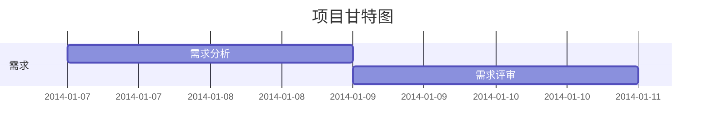

### 横向流程图

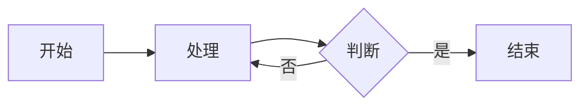

### 标准流程图

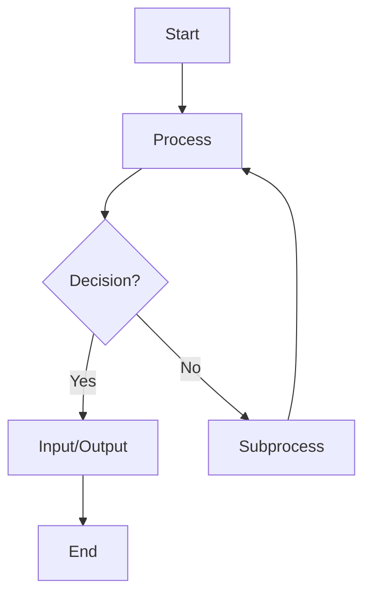

### UML 时序图

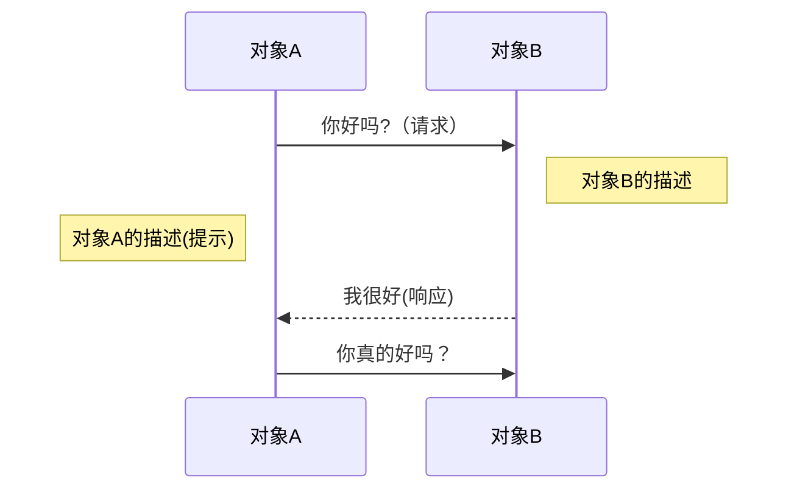

### 饼图 Pie

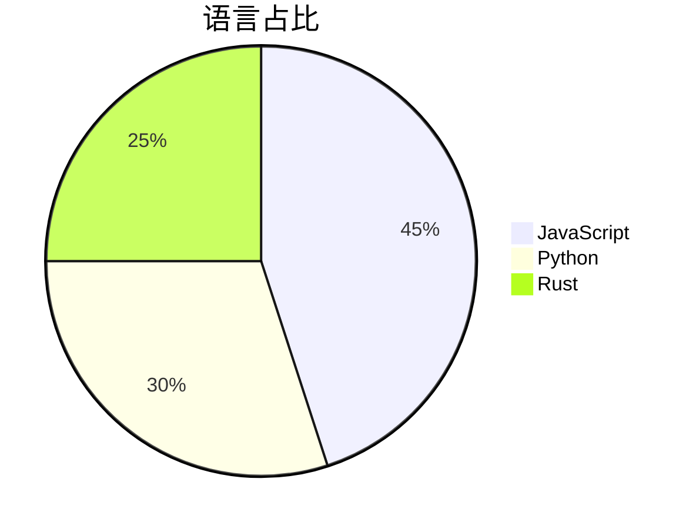

### 思维导图 Mindmap

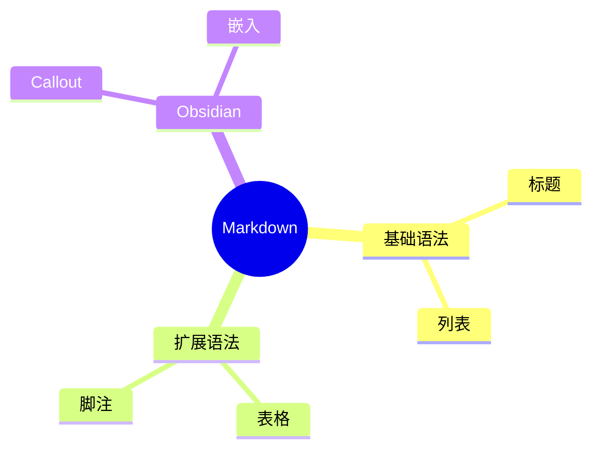

### 时间线 Timeline

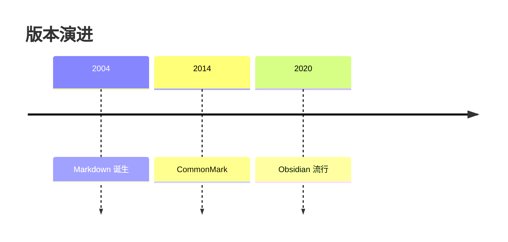

### 类图 Class Diagram

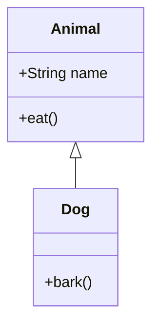

### 状态图 State Diagram

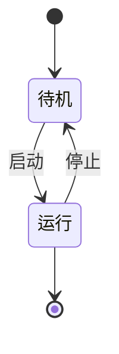

### 实体关系图 ER Diagram

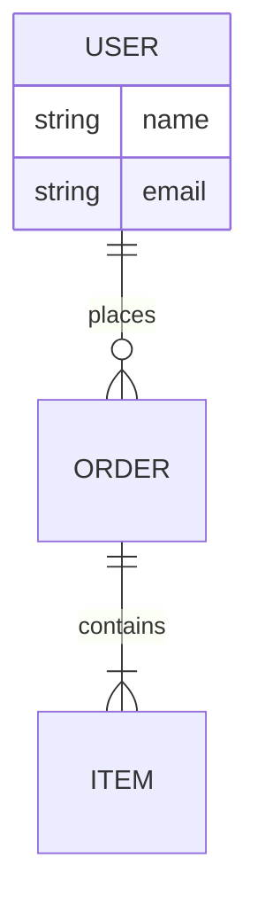

### Git 分支图 Git Graph

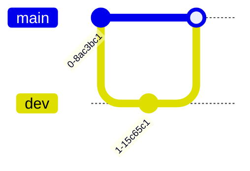

### 四象限图 Quadrant Chart

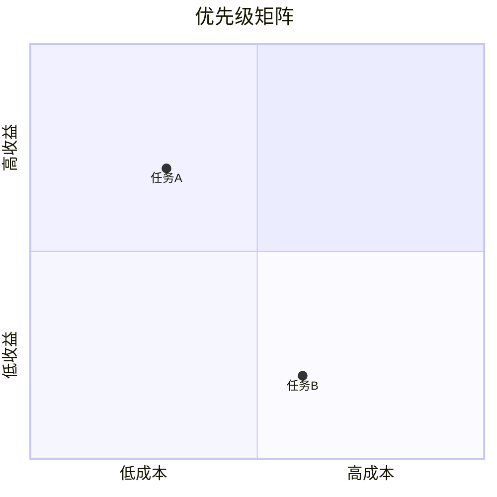

### 用户旅程 Journey

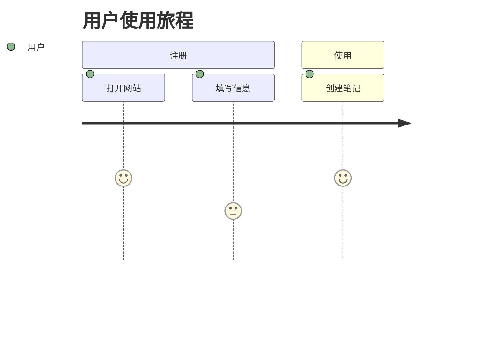

---

## 15. 综合示例

**项目名称**：Markdown 渲染测试
**状态**：`进行中`

| 功能模块 | 完成度 | 备注         |
| -------- | :----: | ------------ |
| 基础语法 |  100%  | 已验证       |
| 扩展语法 |  80%   | 部分待测试   |
| 数学公式 |  90%   | LaTeX 支持   |

> [!TIP] 测试结论
> 如果本页所有元素均能正常渲染，说明当前主题和插件配置**完整支持**标准 Markdown 及 Obsidian 扩展语法。

```javascript
const result = {
  status: "done",
  score: 100,
  message: "All markdown syntax rendered correctly!"
};
```

*文档生成于 2026-03-21，用于 Obsidian 渲染能力验证。*

---

## 16. 纯中文章节测试

笔记系统真正的价值，不在于堆积了多少条目，而在于知识之间能否自由流动。当一条原子笔记可以被多个上下文复用、被不同主题反复调用时，它就不再是孤立的信息碎片，而成为整个知识网络中的一个活跃节点。复用频率越高，这条笔记的实际价值就越大。

写作的过程本身也是一次思考的整理。把模糊的念头落成文字，往往会暴露出逻辑上的断点和论据上的缺口。正因如此，持续记录的习惯比偶尔的灵感爆发更可靠，每天稳定地推进一点，长期累积下来的复利效应远超短时间的集中突击。

维护笔记系统还需要定期的回顾与删减。新增内容固然重要，但及时清理过时的条目、合并重复的概念、修正错误的链接，同样决定了整个系统的健康程度。一个不被打理的知识库会迅速退化成杂物堆，只有持续整理，它才能始终保持可检索、可信任的状态。

---

## 17. 纯英文章节测试

A knowledge base only becomes powerful once its notes begin to connect with one another. Isolated entries, no matter how detailed, tend to fade from memory and rarely resurface when you need them. The moment a note links into a wider web of related ideas, it gains context, becomes easier to retrieve, and starts to contribute to thoughts you have not even formed yet.

Writing things down is also a form of disciplined thinking. Vague impressions feel coherent in the mind, but the act of putting them into clear sentences quickly reveals the gaps in your reasoning. For this reason, steady daily practice tends to outperform occasional bursts of effort, because small consistent contributions compound into something far larger over time.

Maintaining a knowledge base also demands regular pruning and review. Adding new material matters, but trimming outdated entries, merging duplicate concepts, and repairing broken links matter just as much for the overall health of the system. A base that nobody tends to will quickly decay into clutter; only through ongoing curation does it stay searchable, trustworthy, and genuinely useful.
