# Markdown Syntax Full Test Document

> This document tests the rendering of all Markdown syntax in Obsidian. Inline-level syntax (emphasis, inline code, inline links, footnotes, inline formulas, HTML inline, escaping, emoji, inline tags) has been merged into real paragraphs in Section 1 for testing; block-level syntax is still tested separately by section.

---

## 1. Paragraph & Inline

### Chinese Paragraph (with emphasis)

知识管理的核心不在于收藏，而在于**连接**。当一篇笔记能够*主动指向*另一篇笔记时，零散的信息才能沉淀为***可复用的结构化知识***。~~每天写很多~~是不现实的；==坚持每天写一点==比偶尔的爆发更重要。

### English Paragraph

The real value of a note-taking system emerges only when notes start to reference each other. A single **isolated** note is just a *fragment*, but a well-connected network becomes a ***second brain*** that thinks alongside you. Consistency beats intensity.

### Mixed Chinese-English Paragraph (with inline links and footnotes)

很多人误以为 Personal Knowledge Management 只是把文章存到某个地方。实际上，PKM 的关键在于原子笔记之间的 linking[^link]。一篇好的笔记应当足够自包含，同时又通过 [双向链接](https://obsidian.md) 嵌入更大的上下文之中[^note]。

[^link]: 脚注："linking" 指的是笔记之间的双向引用关系。

[^note]: 这是一个支持 **格式化** 内容的命名脚注。

### Inline Code Mixed Paragraph

在终端中运行 `obsidian-cli search "keyword"` 可以搜索整个 vault；使用 `批量重命名` 时，结合 `mv` 和正则表达式来处理 `YYYYMMDDHHmm-` 前缀。插件列表位于 `.obsidian/community-plugins.json`，修改后需要 reload。变量 `count` 的类型是 `number`。

### Inline Formulas, HTML Inline, and Escaping

行内公式：质能方程 $E = mc^2$，求根公式 $x = \dfrac{-b \pm \sqrt{b^2 - 4ac}}{2a}$。HTML 行内元素：上标 X<sup>2</sup>，下标 H<sub>2</sub>O，快捷键 <kbd>Ctrl</kbd> + <kbd>C</kbd>，<mark>HTML 高亮</mark>。转义字符：\*不是斜体\*，\`不是代码\`，\[不是链接\]，\# 不是标题。Emoji：🚀 ✅ ⚠️ 📝 🎉。

### Soft Line Breaks and Obsidian Inline Syntax

这是第一段。段落之间用空行分隔。

这一行末尾有两个空格，所以下一行是软换行。  
这是软换行之后的内容。正文标签 #test-tag #markdown，嵌套标签 #project/frontend #project/backend，行内注释 %%这段在阅读视图不会显示%% 后面还有更多内容。

---

## 2. Headings

# H1 Heading
## H2 Heading
### H3 Heading
#### H4 Heading
##### H5 Heading
###### H6 Heading

---

## 3. Blockquote

> This is a first-level blockquote.
>
> > This is a second-level blockquote (nested).
> >
> > > This is a third-level blockquote.

---

## 4. Lists

### Unordered List

- Apple
- Banana
  - Plantain
  - Pisang Awak
    - Pisang Mas
- Orange

### Ordered List

1. Step one
2. Step two
   1. Sub-step A
   2. Sub-step B
3. Step three

### Task List

- [x] Completed task
- [ ] Incomplete task
- [x] Another completed item
- [ ] To-do item

---

## 5. Code Blocks

### Code Block (no language)

```
This is a plain code block
No syntax highlighting
```

### Code Block (JavaScript)

```javascript
// Fibonacci sequence
function fibonacci(n) {
  if (n <= 1) return n;
  return fibonacci(n - 1) + fibonacci(n - 2);
}

console.log(fibonacci(10)); // 55
```

### Code Block (Python)

```python
# List comprehension
squares = [x**2 for x in range(1, 11)]
print(squares)  # [1, 4, 9, 16, 25, 36, 49, 64, 81, 100]
```

### Code Block (Bash)

```bash
#!/bin/bash
echo "Hello, World!"
for i in {1..5}; do
  echo "Count: $i"
done
```

### Code Block (JSON)

```json
{
  "name": "markdown-test",
  "version": "1.0.0",
  "tags": ["test", "markdown"],
  "active": true
}
```

### Code Block (Diff)

```diff
- const a = 1;
+ const a = 2;
  const b = 3;
```

### Code Block (with filename title)

Some themes/plugins support writing the filename as a title in the fence info:

```js title="utils.js"
export const sum = (a, b) => a + b;
```

---

## 6. Horizontal Rule

Three syntaxes, same result:

---

***

___

---

## 7. Links

### Link with Title

[Link with title](https://obsidian.md "Obsidian - A second brain")

### Reference Link

This is a [reference link][obsidian-ref], defined at the bottom of the document.

[obsidian-ref]: https://obsidian.md "Obsidian"

### Bare Link

<https://obsidian.md>

<test@example.com>

### Obsidian Internal Links (Obsidian-specific)

[[202512191514-readme]]

[[202512191514-readme|Custom display text]]

> [!WARNING] About the alias syntax above
> `[[file|alias]]` — this alias wikilink style has been **globally disabled** in this project: the `|` character conflicts with Markdown table column separators and breaks table rendering. Shown here for syntax demonstration only; for actual writing, please use standard Markdown links `[alias](file.md)` instead.

### Links to Headings and Blocks (Obsidian-specific)

Link to a heading inside a note: [[202512191514-readme#⭐ Optional Settings]]

Link to a block inside a note (paired with Section 11's `^block-id`): [[202603212136-Obsidian-Markdown-Full-Format-Test#^block-id-example]]

Jump to a heading within the same document: [[#9. Tables]]

---

## 8. Images

### External Image


### Image with Title


### Obsidian Internal Image Embed Syntax (Obsidian-specific)

![[assets/00450da751952d255991140f5b2c5ce1_MD5.webp]]

Specify width (pixels):

![[assets/00450da751952d255991140f5b2c5ce1_MD5.webp|300]]

### Obsidian Note Embedding / Transclusion (Obsidian-specific)

Embed an entire note:

![[202512191514-readme]]

Embed a specific section (heading) of a note:

![[202603212136-Obsidian-Markdown-Full-Format-Test#9. Tables]]

Embed a specific block of a note:

![[202603212136-Obsidian-Markdown-Full-Format-Test#^block-id-example]]

---

## 9. Tables

### Basic Table

| Name  | Age  | Occupation    |
| ---   | ---  | ----          |
| Alice | 28   | Engineer      |
| Bob   | 32   | Designer      |
| Carol | 25   | Product Manager |

### Alignment

| Left-aligned | Centered    | Right-aligned |
| :----------- | :---------: | ------------: |
| Left         |   Center    |         Right |
| `left`       |  `center`   |       `right` |

### Line Breaks and Formatting Inside Cells

Use `<br>` for line breaks within cells, and mix with inline formatting:

| Item     | Description                              |
| -------- | ---------------------------------------- |
| Multiline | First line<br>Second line<br>Third line |
| Format   | **bold** and `code` and ~~strikethrough~~ |

---

## 10. Math Formulas (Block-level LaTeX)

$$
\sum_{i=1}^{n} i = \frac{n(n+1)}{2}
$$

$$
\int_{-\infty}^{\infty} e^{-x^2} dx = \sqrt{\pi}
$$

$$
\begin{pmatrix}
a & b \\
c & d
\end{pmatrix}
\begin{pmatrix}
x \\
y
\end{pmatrix}
=
\begin{pmatrix}
ax + by \\
cx + dy
\end{pmatrix}
$$

Multi-line aligned equations (align environment):

$$
\begin{align}
f(x) &= (x+1)^2 \\
     &= x^2 + 2x + 1
\end{align}
$$

> Inline formulas can be found in Section 1.

---

## 11. Block-level HTML & Obsidian-specific Syntax

### Collapsible Block details / summary

<details>
<summary>Click to expand collapsed content</summary>

This is the collapsed content.

- Supports lists
- Supports **formatting**

</details>

### Block Reference ID (Obsidian-specific)

This is a paragraph that can be referenced by other documents. ^block-id-example

### Block-level Comment (Obsidian-specific)

Inline comments can be found in Section 1. Block-level comments (entire block not rendered):

%%
This is a block-level comment,
completely hidden in reading view.
%%

### Callout Blocks (Obsidian-specific)

> [!NOTE]
> This is a Note callout for informational tips.

> [!TIP] Custom Title
> This is a Tip callout, supporting custom titles.

> [!WARNING]
> This is a Warning callout for warning messages.

> [!INFO]- Collapsible Callout (collapsed by default)
> This callout is collapsed by default; click the title to expand.

> [!SUCCESS]+ Collapsible Callout (expanded by default)
> This callout is expanded by default; click the title to collapse.

More types: `ABSTRACT` / `QUESTION` / `EXAMPLE` / `FAILURE` / `BUG` / `TODO` / `CITE` / `DANGER` / `QUOTE`, etc., same usage.

### Nested Callouts (Obsidian-specific)

> [!NOTE] Outer callout
> Outer content.
>
> > [!TIP] Inner callout
> > Nested content inside.

### Mixed Content Inside Callouts (Obsidian-specific)

> [!INFO] Can contain various elements
> Lists:
>
> - Item one
> - Item two
>
> Code blocks:
>
> ```js
> console.log("inside callout");
> ```

---

## 12. Embedded HTML Test

### Inline style Attribute (usually renders)

<span style="color:#e74c3c">Red text</span>, <span style="background:#fff3cd;padding:2px 4px;border-radius:3px">Highlight with background color</span>, <span style="font-size:1.4em;font-weight:bold">Enlarged and bold</span>.

### div Blocks and Box Model

<div style="border:1px solid #2196f3;border-radius:6px;padding:12px;background:#e8f4f8">
  A <code>div</code> box with border, rounded corners, and background color — for testing block-level HTML with inline styles.
</div>

### Two-column Flex Layout

<div style="display:flex;gap:12px">
  <div style="flex:1;padding:8px;background:#f0f0f0">Left column</div>
  <div style="flex:1;padding:8px;background:#e0e0e0">Right column</div>
</div>

### Native HTML Table

<table>
  <thead>
    <tr><th>Column A</th><th>Column B</th></tr>
  </thead>
  <tbody>
    <tr><td>Cell 1</td><td>Cell 2</td></tr>
    <tr><td colspan="2" style="text-align:center">Cell spanning two columns</td></tr>
  </tbody>
</table>

### Native HTML Lists

<ul>
  <li>HTML unordered item one</li>
  <li>HTML unordered item two</li>
</ul>

<ol>
  <li>HTML ordered item one</li>
  <li>HTML ordered item two</li>
</ol>

### Semantic Inline Tags

<small>Small text via small</small>, <ins>Inserted underline via ins</ins>, <del>Deleted strikethrough via del</del>, <abbr title="HyperText Markup Language">HTML</abbr> (hover to see the full abbreviation), <code>inline code tag</code>.

### Progress and Meter

<progress value="70" max="100"></progress> Progress bar via progress

<meter value="0.6" min="0" max="1"></meter> Meter gauge via meter

### figure and figcaption

<figure style="margin:0">
  
  <figcaption style="font-size:0.85em;color:#888">Figure: Official Markdown icon (figcaption)</figcaption>
</figure>

### Preformatted pre

<pre>
Preserves    spaces
and line breaks
inside a pre block
</pre>

### style Tag (expected to be stripped)

> [!WARNING] Known limitation
> Obsidian's reading view **filters out `<style>` tags**, so the block below will not take effect. Custom CSS in notes must be placed in snippet files. This is documented here solely to record that behavior.

<style>
.this-will-be-stripped { color: red; }
</style>

<p class="this-will-be-stripped">If the style above took effect, this line would be red (expected: it won't).</p>

---

## 13. Definition Lists (supported by some renderers)

Apple
: A red or green fruit

Markdown
: A lightweight markup language
: Created by John Gruber in 2004

---

## 14. Diagrams (Mermaid)

### Gantt Chart

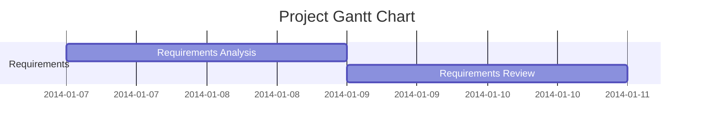

### Horizontal Flowchart

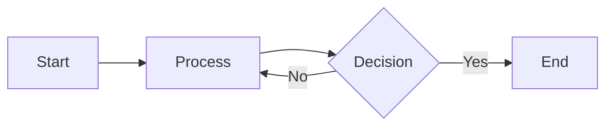

### Standard Flowchart

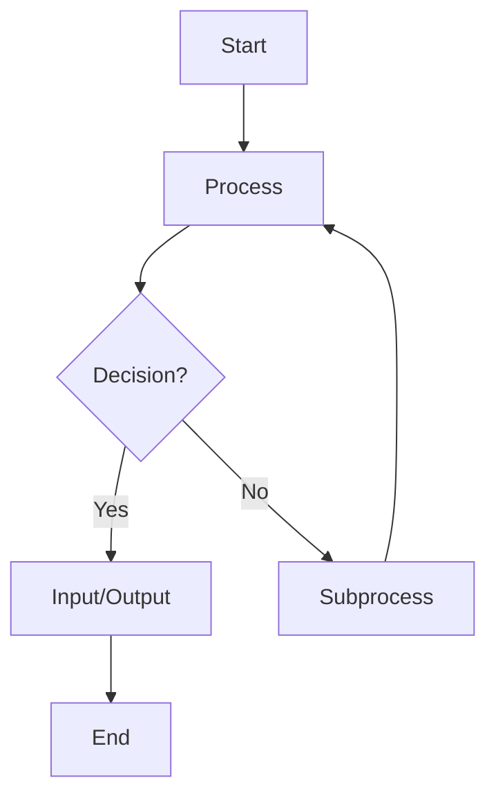

### UML Sequence Diagram

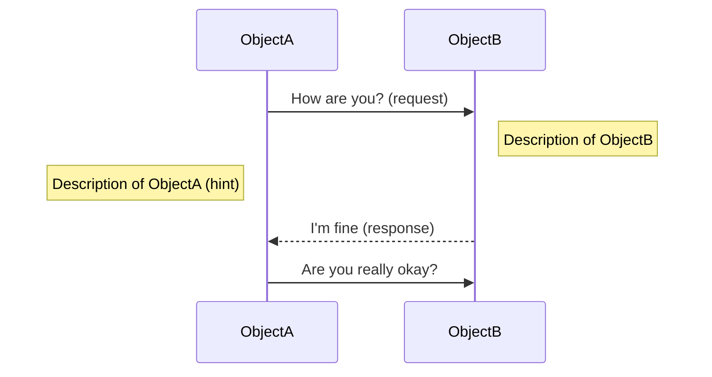

### Pie Chart

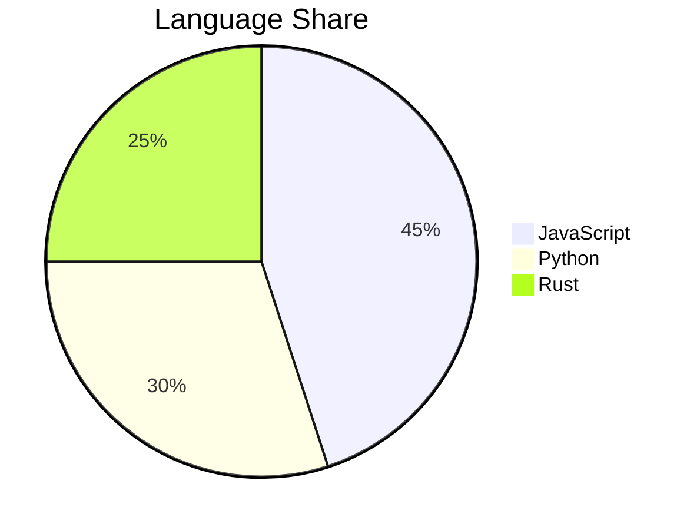

### Mindmap

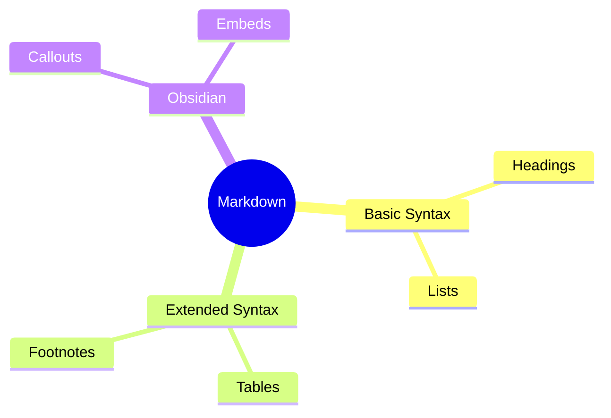

### Timeline

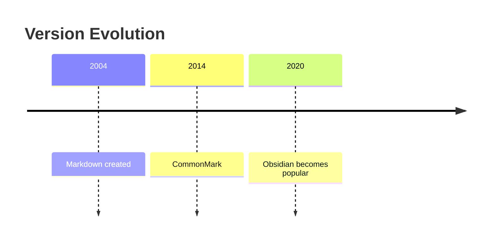

### Class Diagram

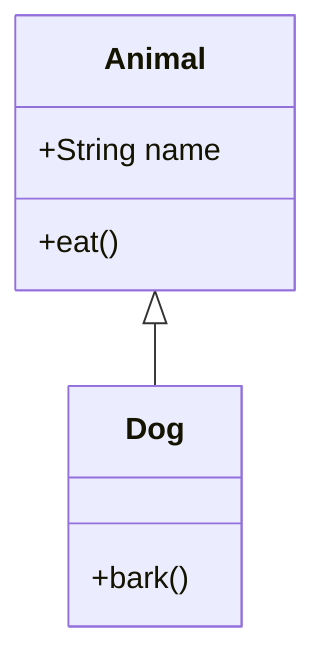

### State Diagram

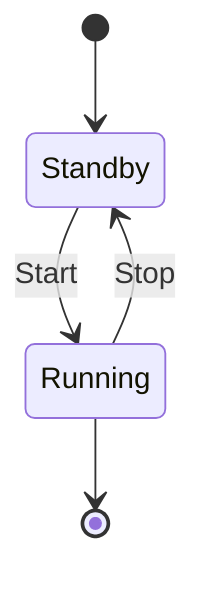

### ER Diagram

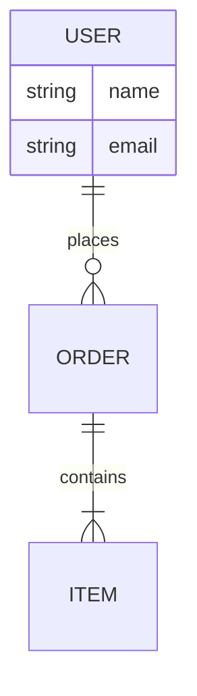

### Git Graph

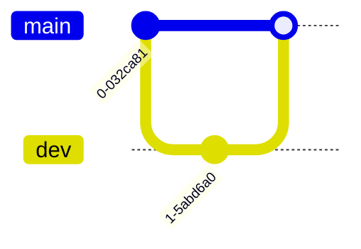

### Quadrant Chart

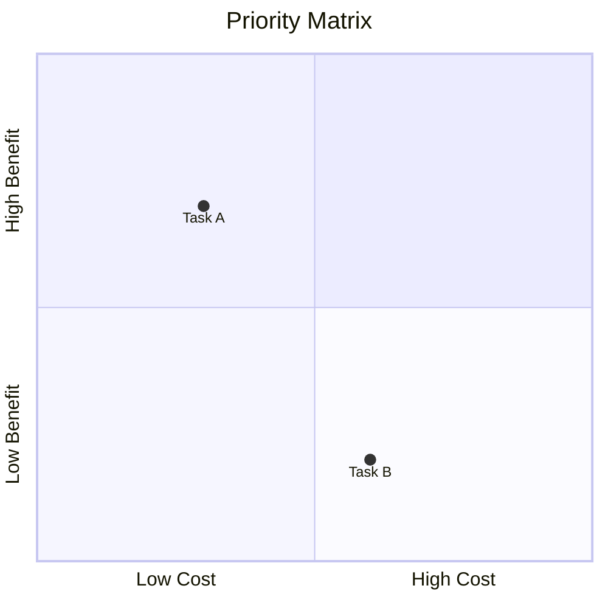

### User Journey

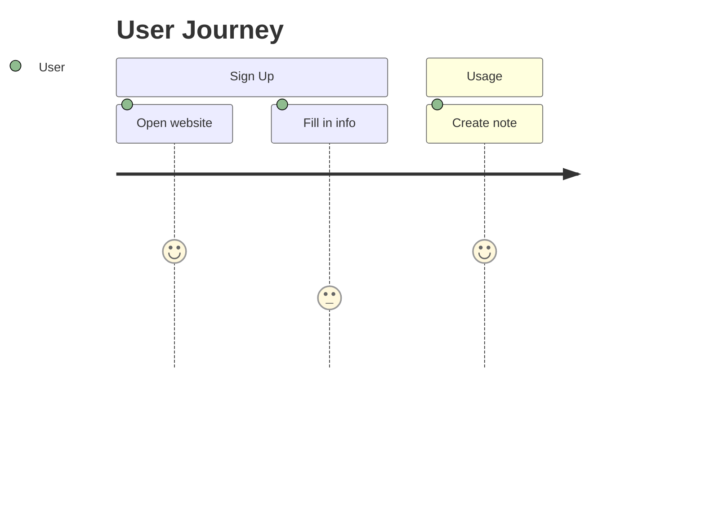

---

## 15. Comprehensive Example

**Project Name**: Markdown Rendering Test
**Status**: `In Progress`

| Module          | Completion | Notes                      |
| --------------- | :--------: | -------------------------- |
| Basic Syntax    |    100%    | Verified                   |
| Extended Syntax |    80%     | Partially pending          |
| Math Formulas   |    90%     | LaTeX support              |

> [!TIP] Test Conclusion
> If all elements on this page render correctly, it indicates that the current theme and plugin configuration **fully support** standard Markdown and Obsidian extended syntax.

```javascript
const result = {
  status: "done",
  score: 100,
  message: "All markdown syntax rendered correctly!"
};
```

*Document generated on 2026-03-21 for Obsidian rendering capability verification.*

---

## 16. 纯中文段落

笔记系统的真正价值不在于你积累了多少条目，而在于知识能否在它们之间自由流动。当一篇原子笔记能够在多个场景中被复用、被不同主题引用时，它就不再是一个孤立的碎片，而是整个知识网络中一个活跃的节点。复用频率越高，笔记的实际价值就越大。

写作本身也是一个整理思维的过程。把模糊的想法写成清晰的文字，往往能暴露出逻辑上的断裂和认知上的盲区。因此，坚持每日记录的习惯比间歇性的灵感爆发更可靠；稳定的小步积累所带来的复利效应，远超短期的集中突击。

维护一个笔记系统同样需要定期回顾和修剪。添加新内容固然重要，但清理过时的条目、合并重复的概念、修复断裂的链接，同样关系到系统的健康状态。一个无人打理的知识库会迅速退化为信息垃圾堆；只有持续地筛选和组织，它才能始终保持可检索、可信任、真正可用的状态。

---

## 17. Pure English Section

A knowledge base only becomes powerful once its notes begin to connect with one another. Isolated entries, no matter how detailed, tend to fade from memory and rarely resurface when you need them. The moment a note links into a wider web of related ideas, it gains context, becomes easier to retrieve, and starts to contribute to thoughts you have not even formed yet.

Writing things down is also a form of disciplined thinking. Vague impressions feel coherent in the mind, but the act of putting them into clear sentences quickly reveals the gaps in your reasoning. For this reason, steady daily practice tends to outperform occasional bursts of effort, because small consistent contributions compound into something far larger over time.

Maintaining a knowledge base also demands regular pruning and review. Adding new material matters, but trimming outdated entries, merging duplicate concepts, and repairing broken links matter just as much for the overall health of the system. A base that nobody tends to will quickly decay into clutter; only through ongoing curation does it stay searchable, trustworthy, and genuinely useful.
