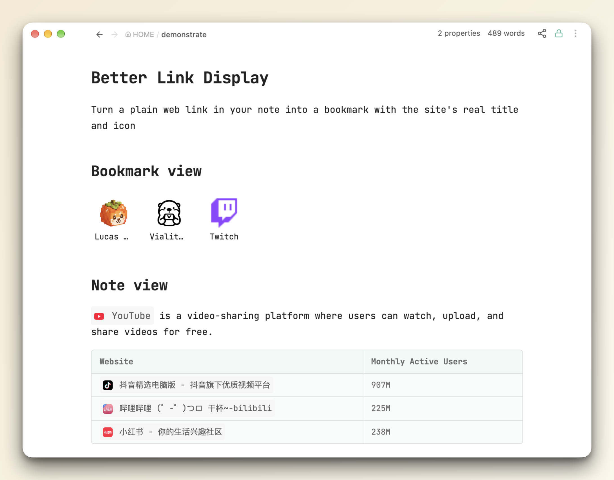
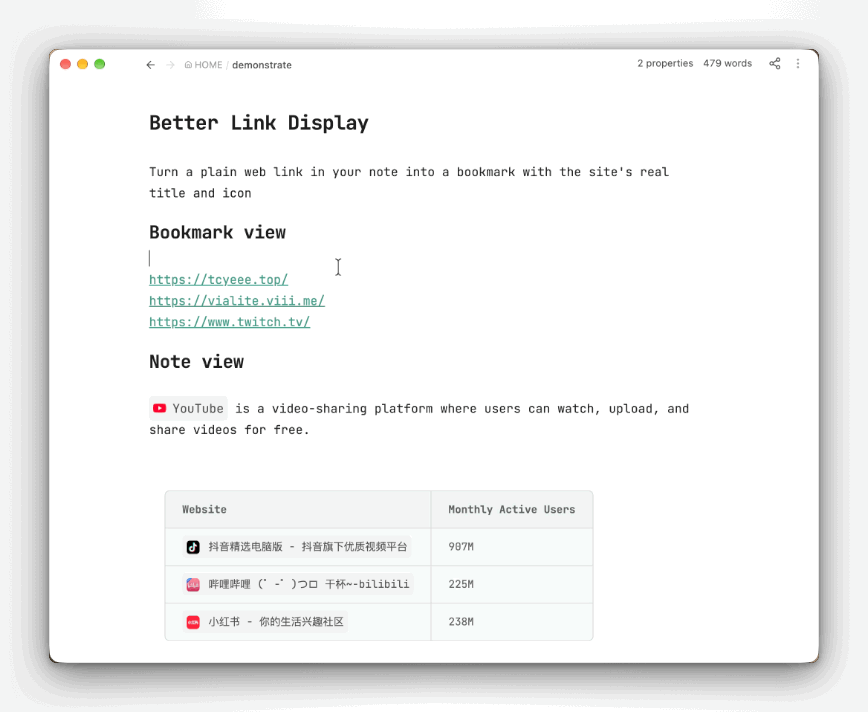
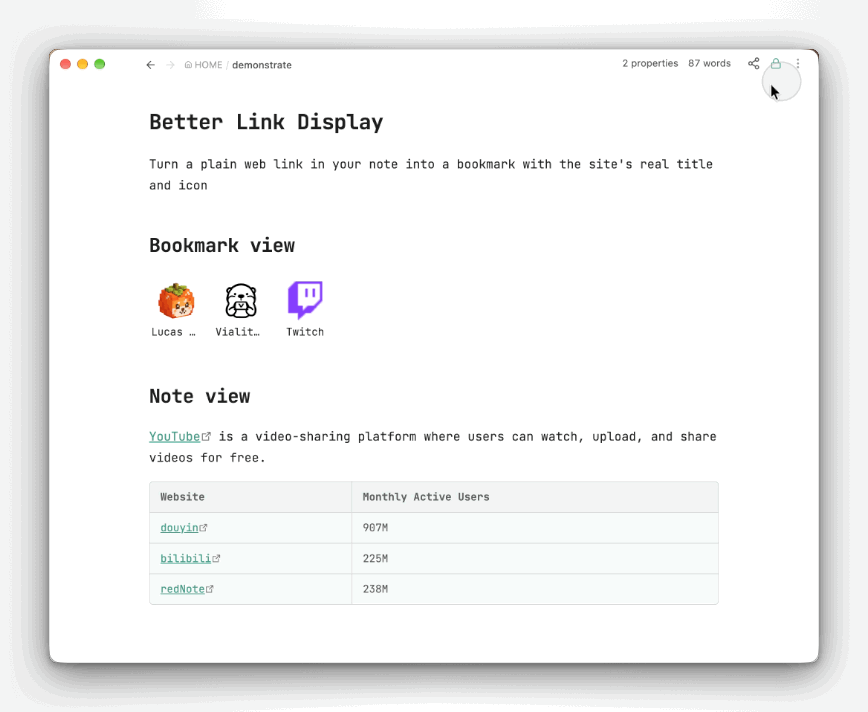

	
	
	
	
	

Turn a plain web link in your note into a bookmark with the site's real title and icon.

It's still an ordinary Markdown link — the icon is inlined as text, so the bookmark keeps working with the plugin disabled, in another vault, or in any other Markdown app.

## ⭐ How to use

**Option 1: Create a bookmark grid.** Right-click in a note and choose "Create bookmark view", then add website links to display them in a grid.

**Option 2: Format an existing link.** Hover over a website link and click "Format" to turn it into a bookmark with the site's icon and title.

## ⬇️ Install

**Community plugins** → **Browse** → search *Better Link Display* → Install → Enable.

Requires Obsidian 1.13+, desktop and mobile.

## Setup

Titles come from a small online service, [Bookmarkify](https://bookmarkify.cc), so you need a free token once:

1. Sign in at [bookmarkify.cc](https://bookmarkify.cc) and create a token.
2. Paste it into **Settings → Better Link Display → Access token**.
3. Click **Test**.

The token is read-only — it can only look up a page's title and icon.

## ⚙️ Settings

| Setting | |
| --- | --- |
| **Language** | English / 中文, following Obsidian by default. |
| **Preview** | Live sample of the two options below. |
| **Background** | Soft grey card behind formatted links. Off by default. |
| **Border** | Light outline around formatted links. Off by default. |
| **Access token** | Your lookup key, with a **Test** button. |
| **Cache location** | Vault-relative folder where bookmark-grid icons and titles are cached. |
| **Cache** | Icons and titles already looked up for bookmark grids, with a **Clear cache** button. |

Background and Border are purely visual and change nothing in your notes.

## Notes

- No menu appears in Reading view, inside code blocks or frontmatter, or on image embeds.
- A bare URL containing brackets — `https://en.wikipedia.org/wiki/Foo_(bar)` — is skipped, since Markdown can't tell where it ends. Wrap it in `<…>` or write it as `[text](url)`.
- Because the icon is inlined, formatted lines look long in Source mode (~1,300–4,800 characters per icon). Live Preview and Reading view show only the icon and title.
- Nothing is sent anywhere until you click **Format**: one lookup request, one icon download (`https` images only).
- The **Format link under cursor** command name only changes language after a restart.
