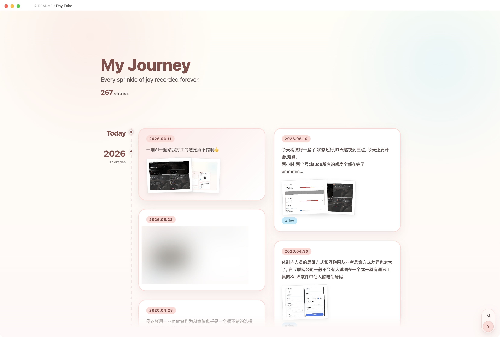

<div style="display:flex;justify-content: center;gap:0.5rem;width:auto">
	
	
	
	
	
</div>

> Gather all your daily notes into one vertical timeline view.

Day Echo is an Obsidian plugin that turns scattered daily notes into a single, scrollable timeline — so months and years of journaling can be scanned at a glance, any day reopened in a click, and writing continued without losing the thread.



## ✨ Features

### Vertical timeline

Collects every daily note in the diary folder into one continuous, two-column timeline:

- A left-hand axis marks each section (month or year), with a running entry count.
- Cards flow newest-first (or oldest-first) and are balanced across two columns.
- A sticky label pins the current section to the top while scrolling, and a **back-to-top** button slides in once you've scrolled past one full screen.
- A small "My Journey" header shows the total entry count.

Open it from the **calendar** ribbon icon on the left, or via the command palette: **Open Day Echo timeline**.

### Rich cards

Each day renders as a preview card:

- A text snippet of the note, with frontmatter, code, and images stripped out.
- Lazy-loaded image thumbnails in a stacked, polaroid style.
- The note's tags (excluding the `#daily` marker).

Click a card to open the full day's note in a **modal popup**; click the date label to open it in the editor.

### Month / Year zoom

A floating segmented control in the bottom-right corner switches between **month** and **year** aggregation. Click a segment, or hold **Ctrl / Cmd / Alt** and scroll the wheel to zoom in or out — the section under the cursor stays anchored. Year view shows only representative entries per year, with a **"show more"** card to expand the rest.

### Today shortcut

In newest-first view, the top of the timeline always reflects today. If today's note already exists, it appears as a highlighted card under a "today" marker; if not, a **"start today's diary"** card creates and opens it.

### Daily-note navigation bar

Opening any date-named daily note (`YYYY-MM-DD`) injects a **previous / next** bar at the bottom, so adjacent days can be stepped through without leaving the editor. This can be toggled off in settings.

### Energy & mood block

Drop an `echo-interaction` code block into any note to rate a day's **energy** and **mood** on a 1–5 scale. Saving writes the scores into that day's frontmatter:

````markdown
```echo-interaction
date: yesterday
```
````

`date` accepts `yesterday` (default), `today`, or an explicit `YYYY-MM-DD`.

The timeline refreshes automatically whenever notes in the diary folder are created, modified, renamed, or deleted.

## ⚙️ Settings

| Setting | Description |
| --- | --- |
| **Daily notes folder** | Folder scanned for daily notes, relative to the vault root. Default: `daily`. |
| **Oldest first** | Default sort direction. Off (default) shows the newest entries at the top. |
| **Show diary navigation** | Show the previous / next bar on top of open daily notes. |

Day Echo treats notes named `YYYY-MM-DD.md` inside the daily folder as diary entries.

## ⬇️ Installation

### From community plugins (recommended)

1. Open **Settings → Community plugins** and disable Restricted Mode.
2. Click **Browse**, search for **Day Echo**, and install it.
3. Enable the plugin.

### Manual install

1. Download `main.js`, `manifest.json`, and `styles.css` from the [latest release](https://github.com/tcyeee/obsidian-day-echo/releases).
2. Copy them into `<your-vault>/.obsidian/plugins/day-echo/`.
3. Reload Obsidian and enable **Day Echo** in **Settings → Community plugins**.

Requires Obsidian `1.5.7` or newer. Works on both desktop and mobile.

## Development & build

```bash
pnpm install
pnpm dev      # watch + rebuild
pnpm build    # type-check + production build
pnpm test     # run the unit tests (vitest)
```
