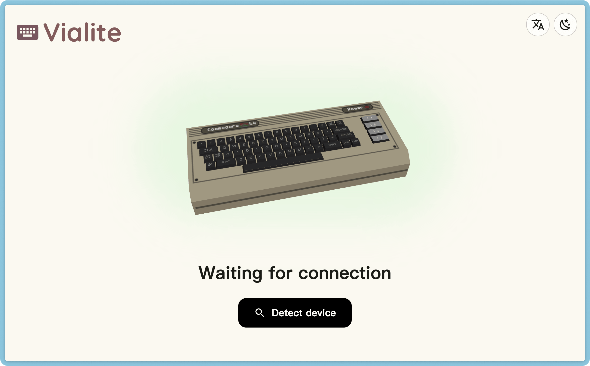
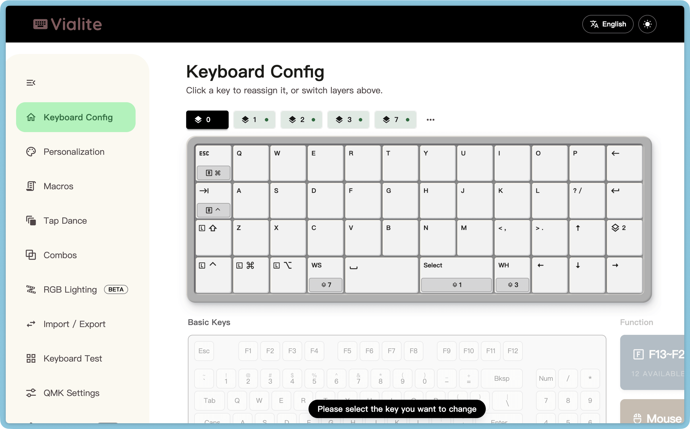

	
	
	
	

  

Vialite is a from-scratch web frontend for Vial-protocol keyboards, talking to the device directly over WebHID instead of wrapping the official vial-gui or vial-web. The Vial HID protocol is reimplemented in TypeScript, ported from vial-gui's Python implementation.

## ✨ Features

- **Keymap editor** — physical-layout renderer with layer-tap and mod-tap editing
- **Keyboard personalization** — customize the on-screen keyboard, with PNG export
- **Macros, Tap Dance & Combos** — edit device-supported dynamic key behaviors
- **RGB Lighting (Beta)** — VialRGB controls, with changes saved to EEPROM on save
- **Import/export** of `.vil` files
- **Keyboard matrix test**, QMK settings, and a 3D preview (Beta)
- **Multi-language UI** — English, Simplified Chinese, Japanese, and French

## 🛠️ Tech Stack

- **Language**: TypeScript
- **Framework**: React + Vite
- **Testing**: Vitest
- **Protocol**: Vial HID protocol, reimplemented from vial-gui

## 📋 Requirements

- Chrome or Edge (WebHID is not supported in Safari or Firefox)
- Node.js + pnpm (for local development)

## 📄 License

This project is licensed under the GPL-2.0 License.
